# Master Master DB: Designing a Fault-Tolerant Peer-to-Peer Distributed Database

> A practical, beginner to advanced guide to replication, versioning, conflict resolution, quorums, and node recovery. Built around three nodes: **A**, **B**, and **C**.

A database can be slow. It can refuse a request. It can return an error.

It must never **silently lose a write it already acknowledged**.

That one rule drives every design decision in this post. We will build up a peer to peer database from first principles, break it with concurrent writes, partitions, and dead nodes, and fix it piece by piece. By the end you will have a concrete architecture you can implement.

Throughout the post you will see two kinds of callouts:

> **Theory:** what a protocol or data structure *guarantees* on paper, under stated assumptions.

> **Practice:** what actually happens in a real system with real disks, real clocks, and real bugs.

Distributed systems fail in the gap between those two. We will keep them separate.

***

## Table of Contents

1. [The Setup: Three Nodes, Three Copies](#0-the-setup-three-nodes-three-copies)
2. [Concurrent Writes and Conflict Resolution](#1-concurrent-writes-and-conflict-resolution)
3. [Network Partitions and Anti-Entropy](#2-network-partitions-and-anti-entropy)
4. [Versioning and Preventing Data Loss](#3-versioning-and-preventing-data-loss)
5. [Node Failure and Replacement](#4-node-failure-and-replacement)
6. [Quorum Consensus](#5-quorum-consensus)
7. [Additional Edge Cases](#6-additional-edge-cases)
8. [Consistency Models, CAP, Raft, Paxos, and CRDTs](#7-consistency-models-cap-raft-paxos-and-crdts)
9. [Recommended Architecture](#8-recommended-architecture)
10. [Implementation Guidelines](#9-implementation-guidelines)
11. [Further Reading](#further-reading)

***

## 0. The Setup: Three Nodes, Three Copies

### 0.1 The cluster

We have three database nodes. Each one keeps a **full, independent copy** of the data. There is **no leader**. Any node can accept a read or a write from any client.

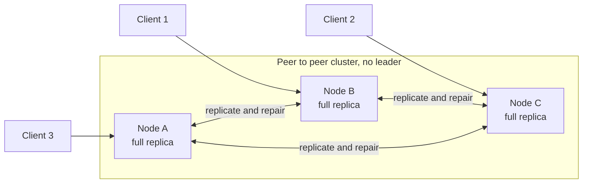

A note on scope. Real systems split data into shards and place each shard on N nodes using consistent hashing. Here we use full replication with N = 3 so we can focus on the hard part: keeping copies correct. Everything below applies per shard.

We will follow one record, `profile:42`, through every failure. Its possible states are:

| State | Meaning |
|---|---|
| **Sx** | The agreed starting state, present on A, B, and C |
| **Sy** | The state B produces when a client updates the record through B |
| **Sz** | The state C produces when a different client updates it through C |

Later, node **D** will join as a replacement for C.

### 0.2 Why this is hard: three facts

1. **There is no shared clock.** Each machine has its own clock. They drift, jump, and disagree.
2. **The network is unreliable.** Messages are delayed, dropped, duplicated, and reordered.
3. **Nodes crash, and you cannot tell crashed from slow.** From A's point of view, a dead C and an unreachable C look identical.

Everything else is a consequence.

### 0.3 Mini glossary

| Term | Plain meaning |
|---|---|
| **Replica** | One node's copy of the data |
| **Operation (op)** | One logical change, such as "set email to x" |
| **Version** | A value plus metadata describing its causal history |
| **Conflict** | Two versions where neither one knew about the other |
| **Convergence** | All replicas end up in the same state |
| **Causality** | "This write happened after that write, and the writer saw it" |
| **Quorum** | A group of nodes large enough that any two groups overlap |
| **Tombstone** | A marker that says "this was deleted" |
| **Anti-entropy** | Background process that compares replicas and fixes differences |

***

## 1. Concurrent Writes and Conflict Resolution

### 1.1 The problem

Start with everything in sync. Then two clients write at nearly the same time, through different nodes.

| Time | Event | A | B | C |
|---|---|---|---|---|
| t0 | All replicas in sync | Sx | Sx | Sx |
| t1 | Client 1 writes through B | Sx | **Sy** | Sx |
| t2 | Client 2 writes through C, before B's update has arrived | Sx | Sy | **Sz** |
| t3 | B and C exchange updates | ? | ? | ? |

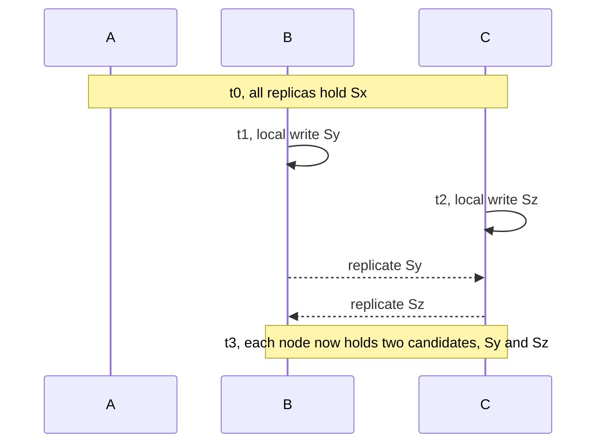

Neither write is "wrong". Neither writer knew about the other. These writes are **concurrent**.

What should the final state be on A, B, and C? A correct answer must satisfy three requirements:

1. **Convergence.** All three nodes end in the same state.
2. **No silent loss.** If a write disappears, the system must have done it deliberately and visibly, not by accident.
3. **Determinism.** The decision must not depend on which node merges first or in what order messages arrive.

There are really only four strategies:

| Strategy | Idea | Cost |
|---|---|---|
| **Pick one** | Choose a winner by rule (LWW) | One write is dropped |
| **Keep both** | Store both as siblings and let the reader decide | Pushes work to the application |
| **Merge** | Combine them with a deterministic function (CRDTs, app merge) | Needs a merge that makes sense |
| **Prevent** | Force a single order with consensus | Loses availability during partitions |

Let us walk through each tool.

### 1.2 Last Write Wins (LWW)

**Intuition.** Attach a timestamp to every write. When two versions conflict, keep the one with the larger timestamp.

```python
def lww_merge(local, incoming):
    # each version carries: value, ts, node_id
    if (incoming.ts, incoming.node_id) > (local.ts, local.node_id):
        return incoming
    return local   # node_id breaks exact ties, so every node picks the same winner
```

This converges. Every node applies the same rule and lands on the same winner. It is also tiny and cheap. That is why Cassandra uses it at the cell level by default.

**The problem is that "last" is decided by clocks, and clocks lie.**

Suppose C's clock runs 5 seconds fast.

| Real time | Event | Timestamp stamped |
|---|---|---|
| 12:00:00 | Client 2 writes Sz through C | 12:00:05 (C is fast) |
| 12:00:01 | Client 1 **reads Sz from C**, edits it, writes Sw through B | 12:00:01 (B is accurate) |
| 12:00:02 | A, B, C sync under LWW | Sz (12:00:05) beats Sw (12:00:01) |

Sw was made *after seeing* Sz. It is causally newer. LWW throws it away anyway. The user's edit vanishes, and nothing reports an error.

Even with perfect clocks, LWW silently drops one of two truly concurrent writes. For Sy versus Sz, one of them is simply gone.

**Mitigation: Hybrid Logical Clocks (HLC).** An HLC pairs the physical time with a logical counter. It never goes backward, stays close to real time, and respects causality (if a write was made after reading another, its HLC is larger). That fixes the "causally newer write loses" bug above. It does **not** fix concurrent writes. HLC just picks the loser in a tidier way.

> **Theory:** LWW gives convergence, and with HLC it also respects causality. It does not preserve concurrent writes. By design, it deletes one.
>
> **Practice:** Use LWW only for data where "latest value wins and losing the other is fine": heartbeats, cache entries, last seen timestamps, sensor readings. Do not use it for anything a user would be upset to lose.

### 1.3 Logical time: Lamport clocks

Leslie Lamport's 1978 insight: you do not need real time. You need to capture "happened before".

```python
on local_event:     L = L + 1
on send(msg):       L = L + 1; msg.ts = L
on receive(msg):    L = max(L, msg.ts) + 1
```

If event e happened before f, then L(e) < L(f). Ties are broken by node id to get a total order.

The catch: the reverse is not true. If L(e) < L(f), you cannot tell whether e caused f or they were simply concurrent. Lamport clocks give a consistent order, but they **cannot detect conflicts**.

To detect concurrency, we need more than one number.

### 1.4 Vector clocks

**Intuition.** Instead of one counter, keep one counter **per node**. A vector says: "I have seen this many events from A, this many from B, this many from C."

Back to our example. A writes the initial value Sx and replicates it everywhere.

| Event | Where | Value | Vector |
|---|---|---|---|
| e1 | A | Sx | `[A:1]`, replicated to B and C |
| e2 | B | Sy | `[A:1, B:1]` (B saw e1, then did its own write) |
| e3 | C | Sz | `[A:1, C:1]` (C saw e1, then did its own write) |

Compare e2 and e3:

* `[A:1, B:1]` has B = 1, but `[A:1, C:1]` has B = 0. So e2 is not before e3.
* `[A:1, C:1]` has C = 1, but `[A:1, B:1]` has C = 0. So e3 is not before e2.

Neither dominates the other. They are **concurrent**. We have detected the conflict with certainty, which is exactly what LWW and Lamport clocks could not do.

```python
def compare(v1, v2):
    keys = set(v1) | set(v2)
    le = all(v1.get(k, 0) <= v2.get(k, 0) for k in keys)   # v1 <= v2 everywhere
    ge = all(v1.get(k, 0) >= v2.get(k, 0) for k in keys)   # v1 >= v2 everywhere
    if le and ge: return "EQUAL"
    if le:        return "BEFORE"       # v1 is an ancestor of v2
    if ge:        return "AFTER"        # v2 is an ancestor of v1
    return "CONCURRENT"                 # neither saw the other

def merge_vectors(v1, v2):
    return {k: max(v1.get(k, 0), v2.get(k, 0)) for k in set(v1) | set(v2)}
```

What to do with each outcome:

| Comparison | Meaning | Action |
|---|---|---|
| v1 BEFORE v2 | v2 descends from v1 | Keep v2. Discard v1 safely. |
| v1 AFTER v2 | v1 descends from v2 | Keep v1. Discard v2 safely. |
| EQUAL | Same version | Nothing to do |
| CONCURRENT | Neither saw the other | **Conflict.** Resolve or keep both. |

The word "safely" matters. Discarding a version that is an ancestor of another loses no information, because the descendant was written by someone who had already seen it.

### 1.5 Version vectors (and how they differ from vector clocks)

The two terms are often mixed up, including in database docs.

| | Vector clock | Version vector |
|---|---|---|
| Tracks | Causality between **events or messages** in a computation | Causality between **versions of a replicated object** |
| Incremented | On every event (classically, sends and receives too) | Only when a replica **updates the data** |
| Compared | To order events | To decide, during sync, which replica has newer data |

Databases almost always use **version vectors**, per key (or per field), even when the docs say "vector clock".

**The client context pattern.** When a client reads a key, it gets the value *and* its version vector, called the **context**. When the client writes back, it sends that context along. The context tells the server precisely which versions the client had seen.

**A subtle bug: concurrent clients through the same node.**

Suppose two clients both read Sx (`[A:1]`) and both write through B, at almost the same moment. A naive server increments B's counter on each write:

* Client 1's write gets `[A:1, B:1]`.
* Client 2's write gets `[A:1, B:2]`.

The second vector dominates the first. The server concludes the second write "came after" the first and drops it. But the two clients never saw each other. **A concurrent write was silently lost**, inside a single node.

The fix is the **dotted version vector** (Preguica et al., 2010). Each version carries a **dot**, the exact id of the write event, e.g. `(B, 1)`. The server discards a stored version only when the client's context *covers its dot*:

```python
def put(self, key, value, ctx):
    dot = (self.id, self.next_counter(key))           # unique id for this write
    # keep every stored version the client had NOT seen
    survivors = [v for v in self.versions[key]
                 if not covered_by(v.dot, ctx)]
    self.versions[key] = survivors + [Version(value, dot, ctx)]

def covered_by(dot, ctx):
    node, counter = dot
    return ctx.get(node, 0) >= counter                # client's context includes this write
```

Now client 2's write does not cover the dot `(B, 1)`, so Client 1's version survives as a **sibling**. Nothing is lost. The conflict is surfaced.

> **Theory:** Version vectors characterize causality exactly. Two versions are concurrent if and only if neither vector dominates.
>
> **Practice:** Per node counters only work if each node's counter is **durable and never reused** (see Section 4). Also, vectors grow with the number of nodes that ever wrote. Teams prune them, and pruning can destroy causal information. Prune with care, and only with a membership aware strategy.

### 1.6 Resolving concurrent versions

Once the system *knows* two versions are concurrent, it has options:

| Strategy | Loses data? | Needs app code? | Typical use |
|---|---|---|---|
| **LWW tiebreak** | Yes, one version | No | Caches, metrics, presence |
| **Siblings (multi value)** | No | Yes, reader merges | Shopping cart style data, Riak style stores |
| **Application merge function** | Depends on function | Yes | Domain rules ("highest priority wins", "union the lists") |
| **CRDT merge** | No, by construction | Choose the right type | Counters, sets, collaborative text, maps |
| **Reject via consensus** | No | No | Uniqueness, balances, invariants |

The first step is always the same: **detect concurrency with version vectors**. The second step is a policy choice, made per data type.

### 1.7 CRDTs: make merging always work

A **Conflict-free Replicated Data Type** is a data structure designed so that replicas can be updated independently and merged in any order, and they still agree.

**State based CRDTs (CvRDTs)** ship their full (or delta) state. Their `merge` function must be:

* **Commutative:** merge(x, y) = merge(y, x)
* **Associative:** merge(merge(x, y), z) = merge(x, merge(y, z))
* **Idempotent:** merge(x, x) = x

Together that makes the state space a *join semilattice*, and state only ever moves "up". Duplicates and reordering become harmless. This is the core reason CRDTs fit unreliable networks.

**Operation based CRDTs (CmRDTs)** ship operations. They need the network layer to give *causal delivery without duplicates* (or make operations idempotent). They send less data, but ask more of the transport.

**Delta CRDTs** are state based CRDTs that ship only the recent change. Most production systems use this form.

#### Example 1: grow only counter (G-Counter)

Each node only increments **its own slot**. The value is the sum. Merge takes the max per slot.

```python
class GCounter:
    def __init__(self, node_id):
        self.id = node_id
        self.counts = {}                       # {"A": 3, "B": 2, "C": 5}

    def increment(self, n=1):
        self.counts[self.id] = self.counts.get(self.id, 0) + n

    def value(self):
        return sum(self.counts.values())

    def merge(self, other):
        for node, c in other.counts.items():
            self.counts[node] = max(self.counts.get(node, 0), c)
```

If A has `{A:3, B:1}` and B has `{B:2, C:5}`, merging gives `{A:3, B:2, C:5}` with value 10. Merge it again, or in a different order, and you still get 10. Increments are never lost, never double counted.

#### Example 2: observed remove set (OR-Set)

Each `add` creates a **unique tag**. A `remove` deletes only the tags it **has observed**.

```python
class ORSet:
    def __init__(self):
        self.adds = {}         # element -> set of unique tags
        self.removed = set()   # tags that were observed and then removed

    def add(self, elem):
        self.adds.setdefault(elem, set()).add(new_unique_tag())

    def remove(self, elem):
        self.removed |= self.adds.get(elem, set())   # only tags I can see right now

    def contains(self, elem):
        return bool(self.adds.get(elem, set()) - self.removed)

    def merge(self, other):
        for e, tags in other.adds.items():
            self.adds.setdefault(e, set()).update(tags)
        self.removed |= other.removed
```

If B removes "x" while C concurrently re-adds "x", C's add has a fresh tag that B never saw. After merging, "x" is present. This is called **add wins**, and it is a deliberate semantic choice, not an accident.

#### Example 3: multi value register

Keeps *all* concurrent values (siblings), tagged with their version vectors. A later write that has seen them all replaces them. This is the CRDT form of "keep both".

#### What CRDTs cannot do

* **They cannot enforce global invariants.** "Balance must not go below zero" and "usernames must be unique" need coordination. Two replicas can each locally approve a withdrawal that is only safe once.
* **They carry metadata.** Tags, tombstones, and vectors grow. You need garbage collection, which needs knowledge about what other replicas have seen.
* **Merge semantics may surprise users.** Add wins versus remove wins is a product decision.

> **Theory:** State based CRDTs guarantee **strong eventual consistency**: any two replicas that have received the same set of updates are in the same state, with no rollback and no coordination.
>
> **Practice:** That guarantee assumes a *correct* merge implementation, durable state, and eventual delivery of all updates. Property test your merge functions (Section 9).

### 1.8 Putting it together: the final answer for Sy versus Sz

| Approach | Final state on A, B, C | What happened to the loser |
|---|---|---|
| LWW | Sy **or** Sz, depending on timestamps | Silently dropped |
| Version vectors, siblings | Both Sy and Sz, with context `[A:1, B:1, C:1]` | Preserved, reader resolves |
| Field level CRDT merge | A merged record: B's changed fields plus C's changed fields | Preserved automatically, unless both changed the *same* field |

Our design (Section 8) uses all three, per field, by declared policy: version vectors to detect, CRDT types where merge is well defined, siblings for fields where a human or app must decide, and LWW only for fields explicitly marked "latest wins".

***

## 2. Network Partitions and Anti-Entropy

### 2.1 What a partition looks like

C loses its connection to A and B. A and B can still talk to each other.

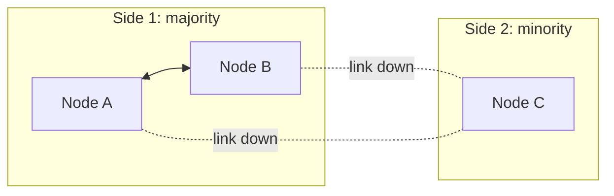

From A and B's view, C looks dead. From C's view, A and B look dead. **Nobody can tell the difference between a crash, a slow node, and a cut cable.** Failure detectors (heartbeats, or the phi accrual detector used by Cassandra and Akka, or SWIM gossip) only produce a *suspicion*, never a certainty.

### 2.2 The design decision: what does C do?

C is alone. It has two options.

| Policy | C's behavior | Result |
|---|---|---|
| **Consistency first (CP style)** | C refuses writes and quorum reads because it cannot reach a majority | No conflicts. C's clients see errors. |
| **Availability first (AP style)** | C keeps accepting writes locally | Clients stay happy. Conflicts must be merged later. |

There is no free option. This is the CAP trade-off in a concrete form (Section 7). Our recommended design makes it a **per data type choice**: quorum mode by default, local acceptance for data types that merge safely.

### 2.3 Timeline

To track what each node has seen, every operation gets an id of the form **(origin, seq)**. A#6 means "the 6th operation created by node A". Each node keeps a **summary** of the highest contiguous sequence number it has applied from each origin.

| Time | Event | A's summary | B's summary | C's summary |
|---|---|---|---|---|
| t0 | Fully synced | A:5, B:3, C:4 | A:5, B:3, C:4 | A:5, B:3, C:4 |
| t1 | C is cut off | same | same | same |
| t2 | A creates A#6, A#7 and sends them to B | A:7, B:3, C:4 | A:7, B:3, C:4 | A:5, B:3, C:4 |
| t3 | B creates B#4, B#5 and sends them to A | A:7, B:5, C:4 | A:7, B:5, C:4 | A:5, B:3, C:4 |
| t4 | C (in AP mode) creates C#5 locally | A:7, B:5, C:4 | A:7, B:5, C:4 | A:5, B:3, **C:5** |
| t5 | Partition heals | ? | ? | ? |

### 2.4 Detecting missing updates

On reconnect, nodes exchange their summaries. The difference between two summaries *is* the list of missing updates.

```python
def missing_ops(mine, theirs):
    """Ranges of operations I have that the peer lacks."""
    ranges = []
    for origin, my_max in mine.items():
        their_max = theirs.get(origin, 0)
        if my_max > their_max:
            ranges.append((origin, their_max + 1, my_max))   # inclusive range
    return ranges
```

Applying that to our timeline:

* A to C: `(A, 6, 7)` and `(B, 4, 5)`. C is missing four operations.
* C to A: `(C, 5, 5)`. A is missing one operation.

This works because sequence numbers per origin are **contiguous**. A gap is a signal. If C receives A#9 while its summary says A:7, it knows A#8 is missing, buffers A#9, and asks for A#8.

### 2.5 Reconnection sequence

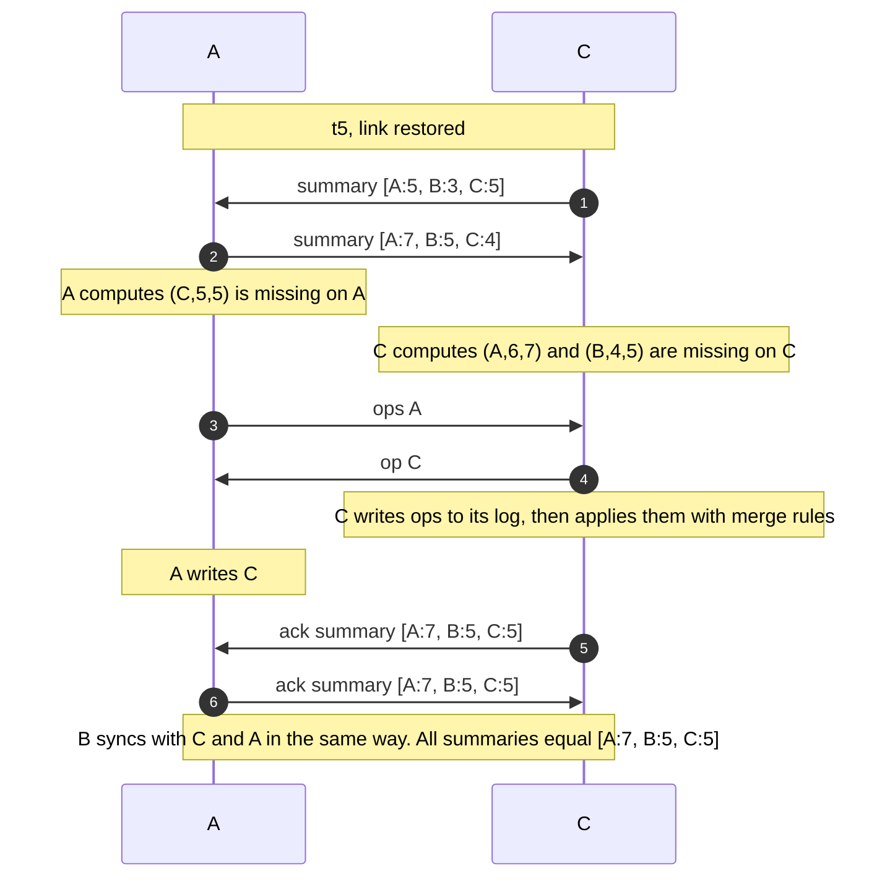

Notice what the exchange does **not** do. It does not overwrite C's state with A's state. It delivers the missing *operations*, and C's own write C#5 flows the other way. If C#5 touched the same field as A#7, the merge rules from Section 1 decide the outcome, and version vectors flag the conflict.

### 2.6 When logs are not enough: Merkle tree anti-entropy

The summary approach assumes both sides still have the operations. It breaks when:

* the op log was truncated past the point the peer needs,
* a bug or disk error made two replicas diverge without any missing op id,
* a node restored from an old backup.

For these, compare **state**. A **Merkle tree** hashes ranges of keys. Leaves hash individual keys (and their versions). Each parent hashes its children. If two nodes have the same root hash, their data is identical. If not, descend only into the subtrees that differ.

```python
def merkle_sync(local, remote, node="root"):
    if local.hash(node) == remote.hash(node):
        return                                   # whole subtree identical, skip it
    if local.is_leaf(node):
        reconcile_keys(local, remote, node)      # exchange versions for these keys
        return
    for child in local.children(node):
        merkle_sync(local, remote, child)
```

Cost is roughly (number of differing keys) times log(total keys) hashes, instead of a full scan.

> **Practice:** Building Merkle trees reads a lot of data. Cassandra's repair, for example, can be expensive enough that operators schedule and throttle it. Maintain trees incrementally if you can, and run them as a *slow safety net*, not the main sync path.

### 2.7 The supporting cast

Anti-entropy is the foundation. Three helpers make it faster.

| Mechanism | What it does | Catches | Limit |
|---|---|---|---|
| **Read repair** | During a read, fix any replica that returned stale data | Hot keys | Cold keys stay stale |
| **Hinted handoff** | While C is down, A or B stores "deliver this to C later" | Short outages | Hints are bounded and can be lost |
| **Gossip** | Nodes spread membership and summaries to random peers | Cluster wide state, in O(log N) rounds | Probabilistic, not instant |
| **Anti-entropy (summary and Merkle)** | Periodic pairwise comparison and repair | Everything above misses | Costs I/O and bandwidth |

> **Theory:** If connectivity is eventually restored and the merge function is correct, anti-entropy guarantees all replicas eventually converge.
>
> **Practice:** "Eventually" depends on how long log retention and tombstone retention last compared with partition length. If C is gone longer than your retention window, log replay is no longer possible, and you need a snapshot transfer or, worse, you risk resurrecting deleted data (Section 6.3).

***

## 3. Versioning and Preventing Data Loss

### 3.1 The scenario

A holds version **V1**. C creates **V2** based on V1. B, independently, creates **V3** based on V1 and never receives V2.

| Step | Event | Version | Where it lives |
|---|---|---|---|
| 1 | V1 exists | V1 | A, B, C |
| 2 | Client updates through C | **V2** | C only (so far) |
| 3 | Client updates through B, B has not seen V2 | **V3** | B only (so far) |
| 4 | B and C sync | ? | ? |

**The naive approach.** Number versions: V1 is "version 1", V2 is "version 2", V3 is "version 3". Higher wins.

Result: V3 beats V2. **V2 is gone.** But V2 and V3 were written in parallel from the same parent. V3 is not "newer" than V2 in any meaningful sense. It just has a bigger number.

### 3.2 The fix: record ancestry, not just a number

Attach a version vector to each version.

| Version | Written on | Vector |
|---|---|---|
| V1 | A | `[A:1]` |
| V2 | C | `[A:1, C:1]` |
| V3 | B | `[A:1, B:1]` |

* V1 is before V2. V1 is before V3. Discarding V1 is safe.
* V2 vs V3: neither dominates. **Concurrent.** Both must be kept.

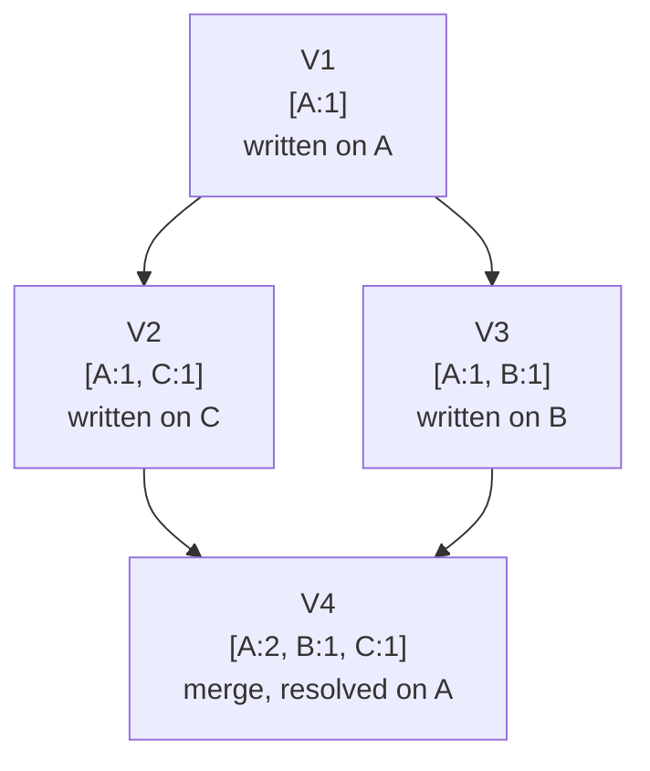

When B and C sync, every node ends up holding **both V2 and V3** as siblings, with a combined context of `[A:1, B:1, C:1]`. When a client or merge function resolves them into V4 and writes it back with that context, V4 dominates both and the siblings collapse. V2's content was either merged into V4 or consciously dropped by a resolver that saw it.

**The invariant:** a version is only ever discarded when some surviving version provably descends from it.

### 3.3 Causal ordering

**Happened before** (written →): operation e happened before f if the same node did e then f, or f's author had received e, or there is a chain of such steps. If neither chain exists, they are concurrent.

**Causal delivery** means a node must not apply an operation until it has applied everything that operation depended on. Example: a comment on a post must not appear before the post.

```python
def deliverable(op, summary):
    # 1. contiguous from its origin
    if op.seq != summary.get(op.origin, 0) + 1:
        return False
    # 2. every dependency already applied
    for node, counter in op.deps.items():
        if node != op.origin and summary.get(node, 0) < counter:
            return False
    return True
```

Operations that fail the check go into a **hold back queue** until their dependencies arrive.

**Session guarantees** are the user facing form of the same idea. If the client carries its context (its last seen version vector) with every request, the system can offer:

* **Read your writes:** you always see your own updates.
* **Monotonic reads:** you never see time go backward.
* **Writes follow reads:** your write is ordered after what you read.

### 3.4 Operation logs

State alone is a *summary*. The **operation log** is the history that makes sync, audit, recovery, and replacement possible.

```python
@dataclass
class Op:
    origin: str        # node that created it, e.g. "B"
    seq: int           # per origin, contiguous, starts at 1
    key: str           # e.g. "profile:42"
    mutation: dict     # e.g. {"set": {"email": "x@y.com"}}
    deps: dict         # version vector the writer had seen (causal context)
    hlc: tuple         # hybrid logical clock, tiebreaks only
    # unique id of an op = (origin, seq)
```

Four rules:

1. **Unique id.** `(origin, seq)` identifies an operation forever.
2. **Append only.** Operations are never edited, only superseded.
3. **Durable before ack.** Write and fsync to the log *before* telling anyone the write succeeded.
4. **Idempotent apply.** Applying the same op twice has the same effect as once.

### 3.5 Snapshots and log compaction

A log that grows forever is not practical. A **snapshot** is the full current state plus the summary vector it corresponds to.

* **Recovery:** load the latest snapshot, then replay operations after its summary.
* **Truncation rule:** drop an op only when **every member** has applied it (it is *causally stable*) **and** a snapshot covers it.
* **Lagging peer:** if a peer needs ops that have been truncated, send it a snapshot, then the log tail.

| Retention choice | Benefit | Risk |
|---|---|---|
| Keep logs a long time | Cheap incremental sync | Disk growth |
| Truncate aggressively | Small disk footprint | Peers that were offline too long need full snapshot transfer |
| Truncate before stability | Smallest | A lagging peer can **never** catch up correctly. This is data loss in disguise. |

### 3.6 Concurrent updates: keep, do not pick

A read that hits concurrent versions returns **all of them** plus the merged context:

```json
{
  "key": "profile:42",
  "versions": [
    { "value": "Sy", "dot": ["B", 1] },
    { "value": "Sz", "dot": ["C", 1] }
  ],
  "context": { "A": 1, "B": 1, "C": 1 }
}
```

The client (or a merge hook inside the database) produces a resolved value Sm and writes it back with that context.

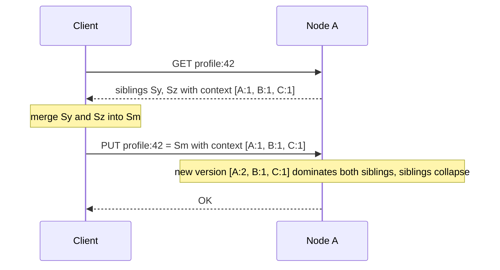

### 3.7 Pitfalls

* **Sibling explosion.** If clients write without context, siblings multiply. Always send context. Alert when siblings per key exceed a threshold.
* **Vector pruning.** To bound vector size, some systems drop old entries. This can create false conflicts or, worse, make a descendant look unrelated. Prune only entries for nodes that were *formally removed* from membership.
* **Using wall clocks as version ids.** See Section 1.2.

| Mechanism | What it protects against |
|---|---|
| Version vectors with dots | Treating concurrent writes as ordered |
| Causal delivery | Applying an effect before its cause |
| Durable operation log | Losing acknowledged writes in a crash |
| Snapshots plus stable truncation | Unbounded growth without breaking catch up |
| Siblings or CRDT merge | Deciding a winner by luck |

***

## 4. Node Failure and Replacement

### 4.1 What "C failed permanently" means

C's disk is gone. It will never come back. What did we lose?

* If every write C acknowledged also exists on A or B, **nothing**. A and B still hold the full history.
* If C acknowledged a write that **only C** had, that write is **gone forever**. No protocol can recover data that no surviving node holds.

That second case is entirely controlled by your **write acknowledgement policy**. With W = 1, C can say "OK" with the only copy. With W = 2, an acknowledged write is on at least two nodes. This is why quorum writes matter (Section 5).

### 4.2 Node identity: the rule that prevents silent corruption

**A node's identity must be separate from its address and its hardware.**

Every operation is named `(origin, seq)`. Version vectors have an entry per node id. That makes node identity *load bearing*.

**The reuse bug.** Say C's disk is wiped and the new machine starts up, still calling itself "C". Its counter restarts at 1. It creates a brand new write and labels it `C#1`. But everyone already has a *different* `C#1` from before. What happens next?

* Peers see `C#1`, think "already applied, duplicate", and **drop it**. The new write is silently lost.
* Or, a peer applies it under the same id with different content. Replicas now **disagree about what C#1 was**, and nothing detects it.

**Rules:**

1. A node id is generated **once**, at first boot on a fresh disk, as a random 128 bit value (UUID or ULID). Display names like "A", "B", "C", "D" are for humans.
2. The id and counters are stored durably, together with the data.
3. **A wiped disk means a new identity.** Never reuse an old id with a lost counter.
4. Never derive identity from IP, hostname, or pod name.

```python
def boot(data_dir):
    meta = read_meta(data_dir)
    if meta is None:                               # fresh disk
        meta = {"node_id": new_uuid(), "incarnation": 1}
        write_meta_durably(data_dir, meta)         # fsync file and directory
    return meta
```

In this post, "D" is the replacement node, with a brand new identity.

### 4.3 Node lifecycle

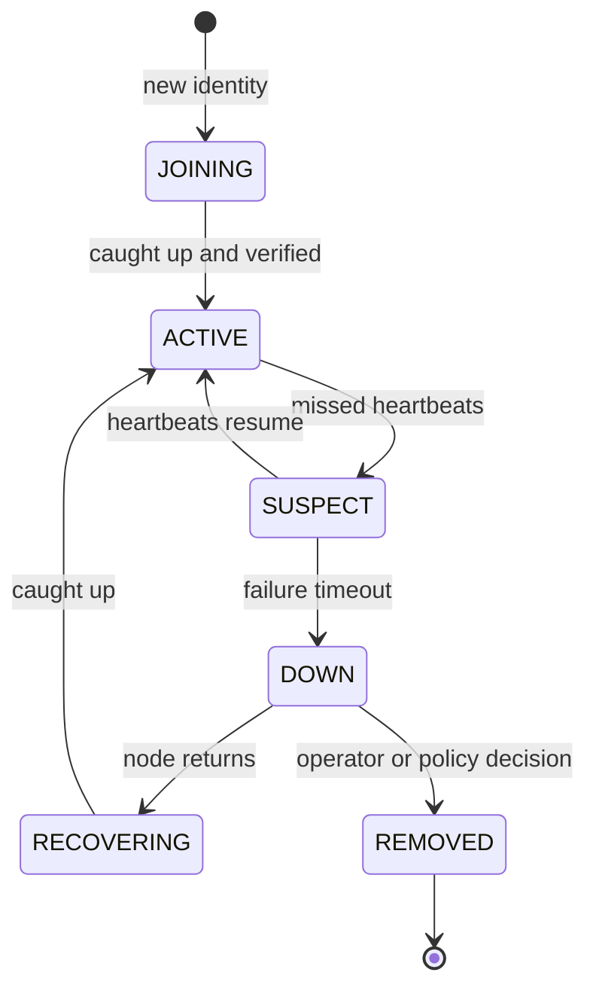

Two ideas matter here.

* **SUSPECT and DOWN are not REMOVED.** A node that is down may come back. Only an explicit, recorded membership decision makes it REMOVED.
* **JOINING and RECOVERING nodes do not count toward quorum.** They receive writes (so they fall no further behind) but cannot be the deciding vote for a read or write until they are verified.

### 4.4 Bootstrapping D

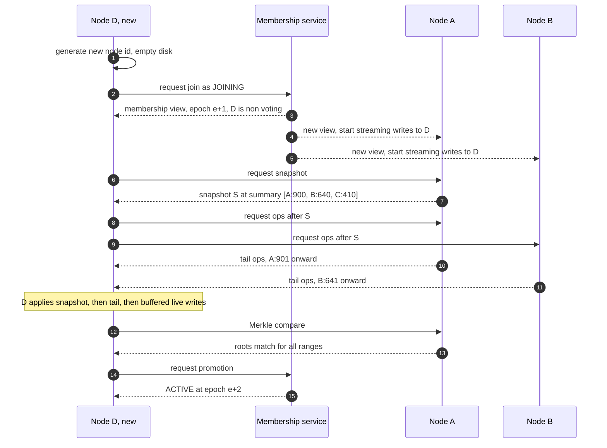

Steps, in words:

1. **Fresh identity.** D picks a new node id.
2. **Register as non voting.** The membership service records D as JOINING. Writes begin streaming to D immediately, so it does not fall further behind while copying history.
3. **Snapshot.** D pulls a consistent snapshot from A (or any healthy peer), tagged with the summary vector at which it was taken.
4. **Tail replay.** D pulls every operation *after* that vector from A and B, using the same `missing_ops` logic as Section 2.
5. **Verify.** D compares Merkle roots against peers. Any mismatch is repaired before D takes a vote.
6. **Promote.** The membership service flips D to ACTIVE under a new epoch.

### 4.5 Safe replacement of C by D

Replacing a node changes the voting set. Done carelessly, two groups can each believe they are the majority.

Safe procedure:

1. **Declare C dead as a membership decision**, recorded by a small strongly consistent service (a Raft group, etcd, or similar). Do not let any one node decide alone.
2. **Add D as a non voting learner** (Step 2 above). Quorums are still computed over {A, B, C}, so a majority is still two of those three.
3. **Promote D after verification.** Move to the new membership {A, B, D} in one epoch step. Do it with a joint step (old and new sets must both agree) when changing several nodes at once, as Raft's joint consensus does.
4. **Bump the epoch and fence C.** Every message carries the sender's epoch. A and B reject anything from a member that is not in the current view.

If C was only *partitioned*, not dead, fencing in step 4 is what stops it from rejoining and corrupting state (Section 6.7).

**Salvaging C's lost tail.** If C later returns with a readable disk, its un-replicated operations `C#n` still have unique ids. They can be imported into the cluster (for example into D) as ordinary operations. Because apply is idempotent and ids are unique, this is safe, and it recovers writes that would otherwise be lost.

### 4.6 Stale replicas

A replica is **stale** if it is missing operations others have. Stale replicas are harmless *if* the system never trusts them alone. They become dangerous when:

* a client reads with R = 1 from the stale node,
* LWW with a skewed clock lets a stale write overwrite a newer one,
* a stale node missed a delete and its tombstone retention window has expired (the data comes back from the dead),
* an old node is promoted without verifying it caught up.

Defense: verify with version summaries and Merkle roots before trusting a node. Treat quorum reads as the source of truth, not any single replica.

### 4.7 Replacement checklist

| Check | Why |
|---|---|
| D has a new node id | Prevents operation id collisions |
| D received snapshot plus tail from at least two peers | No single source of truth |
| D's summary vector is at or ahead of the cluster stable frontier | Nothing missing |
| Merkle roots match peers | Catches silent divergence |
| Epoch bumped, C fenced | Prevents a zombie C from writing |
| C's old vector entries retained | Needed to interpret existing versions |
| Salvage attempted from C's disk if readable | Recovers un-replicated writes |

***

## 5. Quorum Consensus

### 5.1 The intuition

Instead of asking every node for everything, ask *enough* nodes that any two groups must share at least one member. That shared member is the memory that connects a past write to a later read.

### 5.2 Definitions

* **N** = number of replicas for a key (here, 3).
* **W** = number of replicas that must **acknowledge** a write before it succeeds.
* **R** = number of replicas a read must **consult**.
* **Majority** = floor(N / 2) + 1. For N = 3, that is 2.

### 5.3 R + W > N and quorum intersection

**Claim:** if R + W > N, every read set shares at least one node with every successful write set.

**Proof sketch:** a write set has W nodes. A read set has R nodes. If they were disjoint, they would need W + R distinct nodes. But there are only N nodes, and W + R > N. So they cannot be disjoint. Their overlap has at least R + W minus N nodes, which is at least 1.

For N = 3:

| W | R | R + W | Properties |
|---|---|---|---|
| 1 | 1 | 2 | Fast. **No** overlap guarantee. Stale reads are normal. |
| **2** | **2** | **4** | **Balanced. Overlap guaranteed. Survives 1 failure for both reads and writes.** |
| 3 | 1 | 4 | Fast reads. Any single node failure blocks writes. |
| 1 | 3 | 4 | Fast writes. Any single node failure blocks reads. Weak durability. |

A second useful fact: if W > N / 2, any **two** write sets overlap too. That means at least one node sees both of two concurrent writes, which lets it **detect** the conflict.

### 5.4 Walkthrough with A, B, C

W = 2, R = 2. C is unreachable when Sy is written.

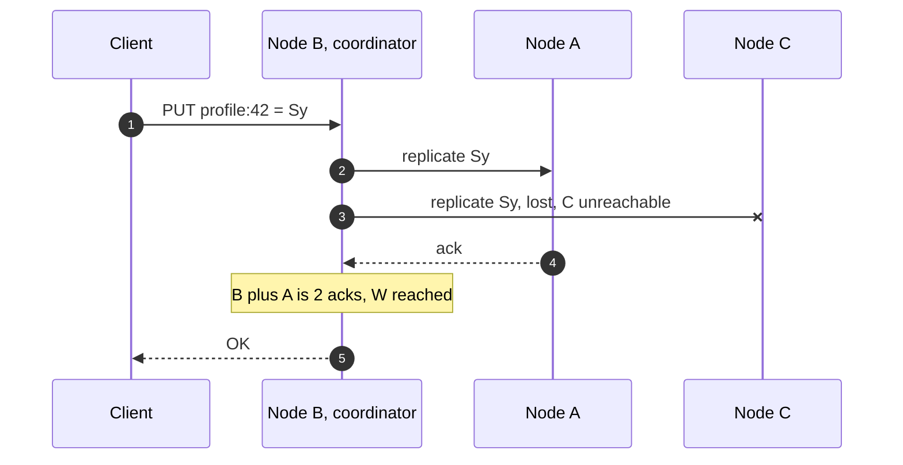

Later, C is reachable again but has not yet been repaired. A client reads with R = 2.

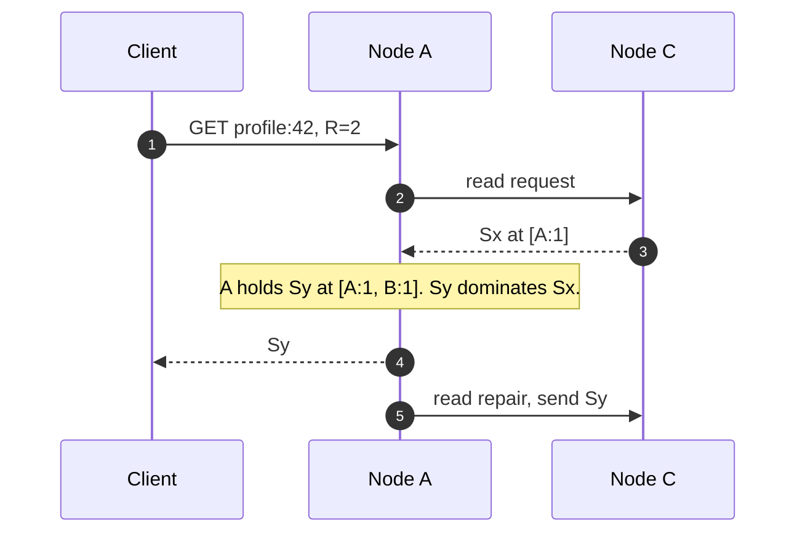

The read set {A, C} overlaps the write set {A, B} at A. A holds the newer version, and the vector comparison proves which one is newer. This is why the quorum is paired with **version vectors, not timestamps**.

### 5.5 What happens when nodes are unavailable

With N = 3, W = 2, R = 2 (strict quorum):

| Nodes reachable | Writes | Reads | Note |
|---|---|---|---|
| 3 (A, B, C) | OK | OK | Normal |
| 2 (any pair) | OK | OK | One failure tolerated |
| 1 | **Fail** | **Fail** | Minority cannot form a quorum |
| 0 | Fail | Fail | |

How many failures can a cluster tolerate for strict quorums?

| N | Majority | Failures tolerated |
|---|---|---|
| 3 | 2 | 1 |
| 4 | 3 | 1 |
| 5 | 3 | 2 |
| 7 | 4 | 3 |

Notice that N = 4 tolerates no more failures than N = 3. Prefer odd cluster sizes.

**What a failed write means.** If a write reaches only 1 of the 2 nodes it needs, the coordinator returns an error. But the write may **still exist** on that one node, and anti-entropy may spread it. A failed write has an **unknown outcome**, not "did not happen". Clients must retry with the **same request id**, and the system must apply requests idempotently.

### 5.6 Sloppy quorums and hinted handoff

A **sloppy quorum** lets the write go to *any* N healthy nodes, not necessarily the ones assigned to the key. A node holding data for someone else keeps a hint and hands it off later. This boosts availability. But it **breaks quorum intersection**, because the "write set" may not overlap the later "read set". With sloppy quorums, R + W > N is no longer a guarantee. It is a hope.

### 5.7 What quorums do **not** give you

This is the most commonly misunderstood part of the whole topic.

> **Theory:** With strict quorums and R + W > N, a read overlaps the latest *completed* write.
>
> **Practice:** That does **not** make a leaderless store linearizable. Known gaps:
>
> * **Concurrent writes still conflict.** Two writers can each reach W nodes with different values. Quorums *expose* the overlap, they do not *serialize* the writes.
> * **Partial writes are visible.** A write that reached 1 of 2 required nodes returned an error, yet a later read may return it. Then a *different* read set might not, and the value seems to disappear. Reads can go backward.
> * **Timestamps decide winners in LWW setups.** Clock skew silently picks the wrong version.
> * **Sloppy quorums, node replacements, and membership changes** can all break overlap if done carelessly.
>
> Register emulation protocols in the style of Attiya, Bar-Noy, and Dolev (ABD) do give linearizable reads and writes with majority quorums. The price is an extra **write back phase on every read** (and, for multiple writers, a read phase before each write to learn the latest timestamp). Most leaderless databases choose not to pay that cost by default.

**Quorums versus consensus.** A quorum gives you *visibility*. Consensus (Raft, Paxos) uses majority quorums to give you *agreement on one order*. The first is a building block for the second, not a replacement.

***

## 6. Additional Edge Cases

Each case below follows the same shape: the scenario, what goes wrong, and the defense.

### 6.1 Simultaneous updates to the same field

**Scenario.** B sets `status = "away"`. C, concurrently, sets `status = "busy"`.

**What goes wrong.** One of them silently wins, or the record ends up inconsistent across nodes.

**Defense.** Pick the policy per field, on purpose:

| Field kind | Policy | Why |
|---|---|---|
| Presence, last seen | LWW with HLC | Losing one is harmless |
| Free text a human edited | Multi value register (siblings) | A human should choose |
| Priority or severity | App merge: highest wins | Domain rule is deterministic |
| Counter | PN-Counter CRDT | Increments from both must count |

### 6.2 Updates to different fields

**Scenario.** B changes `email`. C, concurrently, changes `phone`.

**What goes wrong.** If the *whole record* is one versioned unit, these look like a conflict and LWW drops one change, even though the edits never touched the same data.

**Defense.** Version **per field**.

```json
{
  "email": { "value": "new@x.com", "dot": ["B", 7] },
  "phone": { "value": "99999",     "dot": ["C", 3] }
}
```

Merging is done field by field. B's email and C's phone both survive.

**Caveat.** Fields tied by an invariant must be versioned **together**. If `street`, `city`, and `zip` must agree, treat the address as one unit. Otherwise a merge can produce an address that no human ever wrote.

### 6.3 Concurrent delete and update

**Scenario.** B deletes `profile:42`. C, concurrently, updates its phone number.

**What goes wrong.** Either the update is lost (delete wins) or a deleted record springs back (update wins). Both are defensible. Neither should happen *by accident*.

**Defense.**

* A delete is a **write**. It stores a **tombstone** carrying a causal context.
* A delete removes only what it **observed**. C's update was not observed by B, so it survives. This is the same rule as the OR-Set.
* Choose and document a policy per type: *delete wins*, *update wins (add wins)*, or *surface as a sibling*.

**The zombie problem.** Tombstones cannot live forever. If a tombstone is garbage collected **before** a lagging replica has seen the delete, that replica later pushes its old copy back, and **deleted data returns**. Cassandra defaults to keeping tombstones for 10 days (`gc_grace_seconds`) for exactly this reason.

Rule: keep a tombstone until it is **causally stable** (every member has seen it) *and* longer than the longest outage you will allow a node to survive before it must be rebuilt from scratch.

### 6.4 Duplicate message delivery

**Scenario.** The network, or a retry, delivers the same op twice.

**What goes wrong.** A counter increments twice. A list gets a duplicate entry.

**Defense.** Make every apply **idempotent** by tracking operation ids.

```python
def apply_once(self, op):
    if self.summary.has(op.origin, op.seq):    # already applied
        return
    self.state.apply(op)
    self.summary.advance(op.origin, op.seq)
```

State based CRDTs are idempotent by construction. Operation based designs need this dedup check. Client retries use a **request id** so one logical action maps to one operation.

### 6.5 Out of order message delivery

**Scenario.** B#5 arrives at C before B#4.

**What goes wrong.** Applying B#5 first can break causal order, or make an update to an object that does not exist yet.

**Defense.** A **hold back queue**.

```python
def on_receive(self, op):
    self.log.append_pending_and_fsync(op)       # keep it, durably
    progress = True
    while progress:
        progress = False
        for ready in self.pending_ops():
            if deliverable(ready, self.summary): # contiguous and deps satisfied
                self.state.apply(ready)
                self.summary.advance(ready.origin, ready.seq)
                progress = True
```

B#5 waits. When B#4 arrives, both are applied in order. If B#4 never arrives, the gap is detected by the summary and requested from a peer.

### 6.6 Node crashes during synchronization

**Scenario.** C is receiving a batch of 10,000 operations from A. Power fails halfway.

**What goes wrong.** Half applied state. A summary that claims more than the state contains. Or, the reverse, duplicate work.

**Defense.** Write ahead, apply idempotently, advance the summary last.

| Crash point | State on restart | Outcome |
|---|---|---|
| Before batch is written to the log | Nothing received | Peer resends, no harm |
| After the log write, before apply | Ops pending in the log | Replay applies them |
| Mid apply | Some ops applied, summary not advanced | Replay re-applies, idempotence makes it safe |
| After apply, before summary advance | State ahead of summary | Same, replay is a no op |
| After summary advance | Complete | Done |

The golden rule: **never advance the summary past what is durable**. If the summary says "I have B#5" but B#5 is not on disk, the peer will not resend it, and the op is lost forever.

### 6.7 A node reconnecting with stale data

**Scenario.** C returns after three days with an old but valid disk.

**What goes wrong.**

* It serves stale reads to clients that use R = 1.
* Its stale writes, stamped with its fresh clock, beat newer data under LWW.
* If C was removed and replaced by D in the meantime, it is a **zombie**.

**Defense.**

1. On start, C enters **RECOVERING**. It does not serve quorum votes until it catches up.
2. C checks its epoch. If the cluster says C was removed, C stops serving, and its disk is quarantined for salvage (Section 4.5).
3. C's writes carry a context. A stale context makes its write *concurrent* with newer versions, so it never silently overwrites them.
4. Clocks are checked against peers. A node whose clock is far off is not allowed to produce LWW timestamps.

### 6.8 Permanent data loss

Be honest about what no protocol can fix.

| Scenario | Is data lost? | Mitigation |
|---|---|---|
| One disk dies, writes had W = 2 | No | Rebuild from peers (D joins) |
| One disk dies, writes had W = 1 and had not replicated | **Yes** | Use W = 2 for anything important |
| Two of three disks lost after a W = 2 ack | **Possibly** | Place replicas in different failure domains, keep backups |
| Silent disk corruption | Detectable | Checksums on every block and log record, periodic scrubbing, repair from peers |
| `fsync` that lies (bad hardware or firmware) | **Yes**, undetected | Hardware testing, power loss tests, replication as a second line |
| A buggy merge that discards data | **Yes**, silently | Property tests, audit logs, backups with point in time restore |
| Operator deletes everything | **Yes** | Backups, delayed delete protection |

> **Theory:** Replication tolerates up to N minus 1 crashed nodes *if* each acknowledged write reached enough of the surviving ones.
>
> **Practice:** Replication is **not** a backup. A bad write or a bad delete replicates just as faithfully. Keep point in time backups outside the cluster.

### 6.9 Network partitions involving multiple groups

Real partitions are rarely a clean two way split. Consider three isolated groups, and asymmetric links.

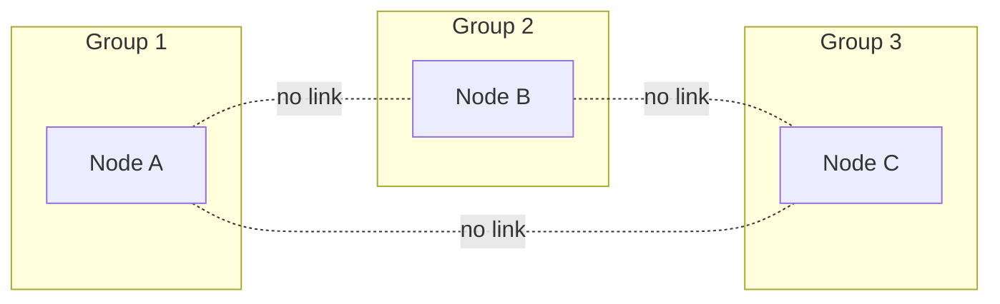

**Strict quorum mode (N = 3, W = 2).** No group has a majority. **Every group refuses writes.** The cluster is unavailable but consistent. That is the price of strong guarantees.

**AP mode for CRDT backed fields.** Every group accepts writes. When links return, the three branches merge. Because merge is **commutative and associative**, it does not matter whether A merges with B first or with C first. All paths end at the same state.

**Asymmetric partition.** A can reach B, B can reach C, but A cannot reach C.

* Gossip spreads A's updates to C **through B**.
* A write coordinated by A can still reach W = 2 using B.
* Failure detectors may disagree about who is alive, so membership changes must go through the control plane, not through individual opinions.

**Flapping links.** A link that goes up and down every few seconds can cause repeated leader changes in consensus systems and repeated hint storms in leaderless ones. Dampen: require a node to be unreachable for a sustained period before changing its state, and rate limit repair traffic.

### 6.10 Summary table

| Edge case | Primary defense |
|---|---|
| Same field, concurrent | Per field policy: LWW, siblings, CRDT, app merge |
| Different fields | Field level versioning |
| Delete versus update | Tombstones with causal context, explicit policy |
| Duplicates | Operation ids, idempotent apply |
| Reordering | Hold back queue, causal delivery |
| Crash during sync | Log first, idempotent apply, summary advances last |
| Stale reconnect | RECOVERING state, epochs, contexts on writes |
| Permanent loss | W of at least 2, fsync, checksums, backups |
| Multi group partition | Quorum mode refuses, CRDT mode merges associatively |

***

## 7. Consistency Models, CAP, Raft, Paxos, and CRDTs

### 7.1 A ladder of guarantees

| Model | Promise | Example systems |
|---|---|---|
| **Linearizable (strong)** | The system behaves as if there is **one copy**, and every operation takes effect at one instant between its start and finish | etcd, Spanner, single leader Raft clusters |
| **Sequential** | All nodes see operations in the same order, not necessarily real time order | Some replicated state machines |
| **Causal** | If one operation caused another, everyone sees them in that order. Concurrent ones may differ | Systems with causal sessions, our recommended design for per key data |
| **Eventual** | If writes stop, replicas eventually agree. No ordering promise in the meantime | Many leaderless stores |
| **Strong eventual** | Replicas that have received the same updates are in the same state, immediately and without rollback | State based CRDTs |

### 7.2 Strong consistency, concretely

Client 1 writes Sy and receives OK. Client 2 starts a read **after** that OK. Under linearizability, Client 2 **must** see Sy or something newer. It can never see Sx.

In our three node cluster, that means every operation behaves as if A, B, and C were a single machine. To get this, you need a single agreed order of writes, which means **consensus**.

### 7.3 Eventual consistency, concretely

Client 1 writes Sy through B and gets OK. Client 2 reads from C a millisecond later and sees Sx. A moment later, C sees Sy. Replicas **converge**, but there is a window where they disagree, and the system does not bound how long it lasts.

### 7.4 The CAP theorem, stated carefully

**Statement (Gilbert and Lynch, 2002, formalizing Brewer's conjecture).** In an asynchronous network, no system can provide both **linearizability** and **availability** (every request to a non failed node gets a non error response) while tolerating **network partitions**.

Common misreadings:

* "Pick any two of three" is misleading. **Partitions are not optional.** The real choice is what you give up *during* a partition.
* CAP's "C" means linearizability, not "any kind of consistency". CAP's "A" means *every* non failed node answers, which is stricter than "mostly up".
* CAP says nothing about normal operation. **PACELC** (Abadi) adds: *else*, when there is no partition, you still trade **latency** for **consistency**.

In our cluster:

* Partition isolates C. **Consistency first:** C returns errors. **Availability first:** C accepts writes and the system merges later.

### 7.5 Raft

Raft keeps a **replicated log** with an elected **leader**.

* Writes go to the leader, which appends and replicates to followers.
* An entry is **committed** once a **majority** has stored it.
* A new leader can only be elected by a majority and must have all committed entries.
* Cluster of 2f + 1 nodes tolerates f failures.

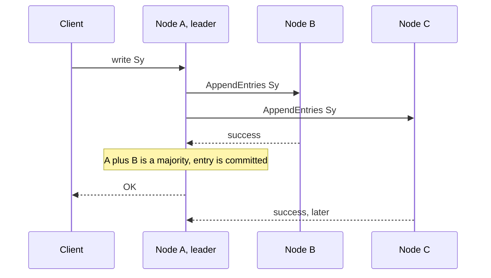

If C is partitioned, A and B continue. If A is partitioned alone, B and C elect a new leader and A, as a minority, can no longer commit anything.

### 7.6 Paxos

Paxos solves the same problem: agreeing on a value among nodes that can fail.

* **Single decree Paxos** agrees on one value, using two phases (prepare and accept) with majority quorums.
* **Multi Paxos** chains decisions into a log, usually with a stable leader.
* Safety rests on the same fact as Raft: **any two majorities overlap**.

Raft was designed to be easier to understand and implement. Paxos is more general and has many variants (Fast Paxos, EPaxos and others). Spanner and Chubby use Paxos family protocols.

### 7.7 CRDT based replication

No leader, no global order, no consensus. Every node accepts writes and merges whatever it receives.

### 7.8 Comparison

| Property | Raft | Paxos (Multi Paxos) | CRDT based |
|---|---|---|---|
| Consistency | Linearizable | Linearizable | Strong eventual |
| Availability in a minority partition | **No** | **No** | **Yes** |
| Needs a leader | Yes | Usually | No |
| Write latency | One round trip to a majority | Same | Local write, then async |
| Handles concurrent writes | Serializes them | Serializes them | Merges them |
| Enforces invariants (uniqueness, balance) | **Yes** | **Yes** | **No** |
| Merge semantics to design | None | None | **Yes**, per data type |
| Metadata growth | Log compaction | Log compaction | Tombstones, tags, vectors |
| Implementation complexity | Moderate | High | Moderate to high, mostly in data type design |
| Real examples | etcd, Consul, CockroachDB ranges | Spanner, Chubby | Riak data types, Redis Enterprise Active-Active, collaborative editors |

### 7.9 How to choose

| If you need | Use |
|---|---|
| Never refuse a write, even partitioned (offline apps, geo distributed writes) | CRDTs and version vectors |
| Uniqueness, balances, locks, leader election, schema changes | Consensus (Raft or Paxos) |
| Both | **Hybrid**: CRDT data plane, consensus for membership and rare critical operations |

> **Theory:** Raft and Paxos are proven safe under their failure model, with machine checked specifications available (for example TLA+ for Raft).
>
> **Practice:** Implementations still have bugs. Jepsen has found violations in many production systems that claimed these guarantees. Prove the protocol, then **test the implementation** under faults.

***

## 8. Recommended Architecture

### 8.1 Goals and non goals

**Goals**

* Never silently lose an acknowledged write.
* Stay correct through crashes, partitions, duplicates, and reordering.
* Remain available for merge friendly data when partitioned.
* Allow safe replacement of nodes.

**Non goals**

* Cross key ACID transactions.
* Global linearizability for all data.
* Enforcing uniqueness or numeric invariants without coordination (route those to a consensus path).

### 8.2 Components

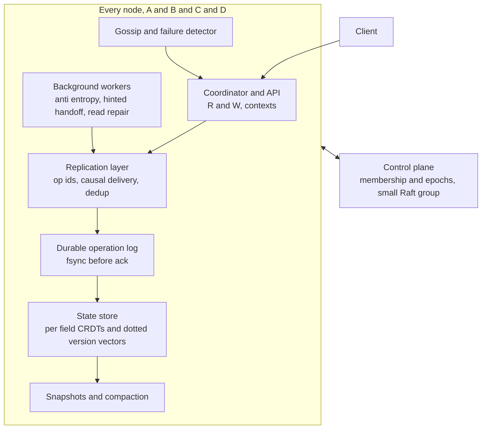

| Layer | Responsibility |
|---|---|
| **Coordinator and API** | Accepts client requests, picks replicas, enforces R and W, returns values with contexts |
| **Replication layer** | Assigns operation ids, delivers causally, drops duplicates, buffers out of order ops |
| **Durable operation log (WAL)** | Source of truth for what this node has accepted. fsync before ack |
| **State store** | Materialized state: per field CRDTs or sibling sets with dotted version vectors |
| **Snapshots and compaction** | Bound disk use. Truncate only causally stable history |
| **Background workers** | Anti entropy (summaries and Merkle), hinted handoff, read repair, tombstone GC |
| **Gossip and failure detector** | Spread membership and summaries, produce suspicion (never certainty) |
| **Control plane** | Strongly consistent membership: node identities, epochs, join, replace, remove |

The key design move is the split. The **data plane** is leaderless and highly available. The **control plane** is a small consensus group that decides *who is in the cluster*. Membership decisions must never be made by gossip alone.

### 8.3 Write path

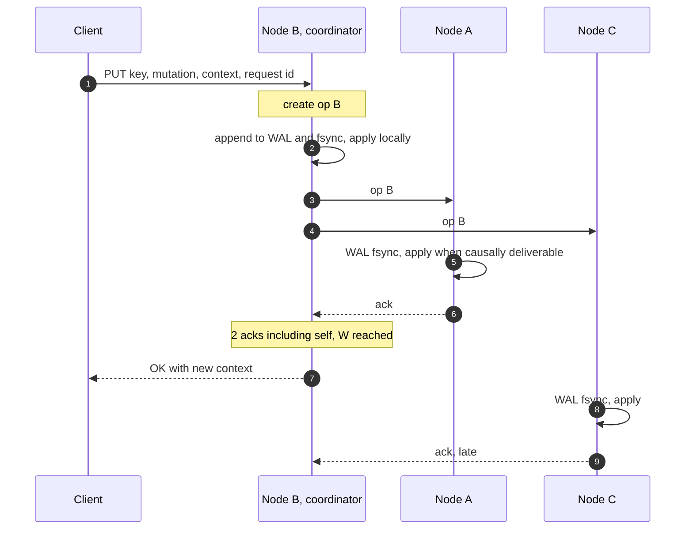

### 8.4 Read path

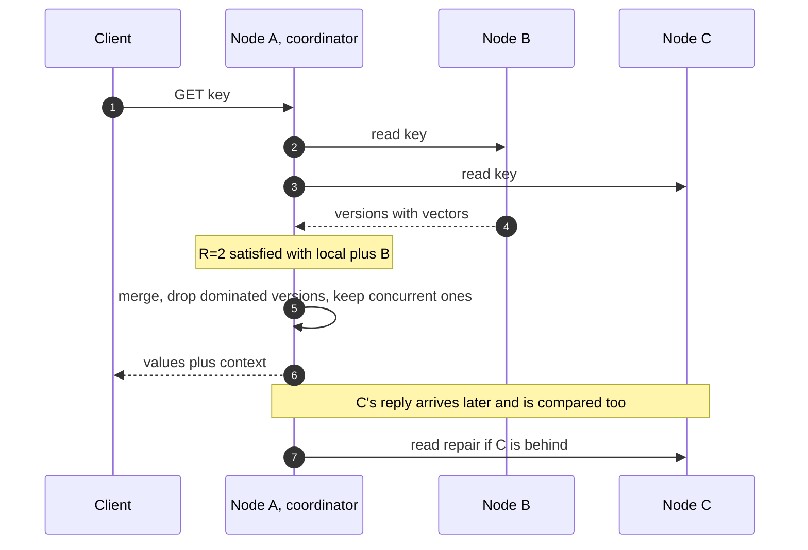

### 8.5 Core pseudocode

**Write coordination**

```python
def handle_client_write(self, key, mutation, ctx, request_id, W):
    if self.seen_request(request_id):
        return self.previous_result(request_id)          # idempotent retry

    op = Op(origin=self.id, seq=self.log.next_seq(),
            key=key, mutation=mutation, deps=ctx, hlc=self.clock.now())

    self.log.append_and_fsync(op)                         # 1. durable first
    self.state.apply(op)                                  # 2. local apply
    self.summary.advance(op.origin, op.seq)

    for peer in self.replicas_for(key):                   # 3. fan out in parallel
        send_async(peer, op)

    acks = 1 + wait_for_acks(min_needed=W - 1, timeout=T)
    if acks >= W:
        return OK(op.id, new_context(key))
    return UNKNOWN_OUTCOME(op.id)                         # may still spread, client retries
```

**Replica receive**

```python
def handle_replicate(self, op):
    if self.summary.has(op.origin, op.seq) or self.log.has_pending(op.id):
        return ACK                                        # duplicate
    self.log.append_pending_and_fsync(op)                 # durable before ack
    for ready in self.deliverable_ops():                  # contiguous seq, deps met
        self.state.apply(ready)                           # idempotent per field merge
        self.summary.advance(ready.origin, ready.seq)
    return ACK
```

**Read with repair**

```python
def handle_client_read(self, key, R):
    replies = [self.local_read(key)] + ask_peers(key, need=R - 1)
    merged = merge_versions(replies)                      # drop dominated, keep concurrent
    stale = [r.peer for r in replies if r.versions != merged.versions]
    send_repair_async(stale, merged)                      # read repair
    return merged.values, merged.context                  # client sends context with next write
```

**Anti-entropy loop**

```python
every ANTI_ENTROPY_INTERVAL:
    peer = pick_random_active_peer()
    mine, theirs = self.summary, peer.get_summary()
    push(peer, ops_in(missing_ops(mine, theirs)))         # fast path, op log
    pull(peer, missing_ops(theirs, mine))
    if now() - self.last_merkle[peer] > MERKLE_INTERVAL:
        merkle_sync(self.state, peer.state)               # slow path, catches the rest
```

**Per field merge**

```python
def merge_field(local, incoming, policy):
    if policy == "crdt":
        return local.crdt_merge(incoming)
    order = compare(local.vv, incoming.vv)
    if order == "BEFORE": return incoming
    if order in ("AFTER", "EQUAL"): return local
    # concurrent
    if policy == "lww":      return max(local, incoming, key=lambda v: (v.hlc, v.origin))
    if policy == "siblings": return Siblings(local, incoming)
    if policy == "app":      return app_merge(local, incoming)
```

### 8.6 Recommended defaults

These are starting points, not laws. Tune them against your workload and failure data.

| Setting | Suggested start | Reason |
|---|---|---|
| Replication factor N | 3 | Tolerates one failure |
| Write quorum W | 2 | Acked writes live on at least two nodes |
| Read quorum R | 2 | R + W > N |
| Log durability | `fsync` before ack | Survive power loss |
| Clock | Hybrid logical clock | Safe tiebreaks, bounded drift |
| Summary exchange | Every few seconds, random peer | Fast convergence |
| Merkle repair | Hourly to daily, throttled | Safety net without I/O storms |
| Hint window | Hours, bounded | Short outages healed cheaply |
| Tombstone retention | Longer than the longest allowed outage (days) | Prevent zombies |
| Failure to DOWN | Tens of seconds to minutes | Avoid flapping |
| DOWN to REMOVED | **Human or explicit policy, never automatic by gossip** | Prevent split decisions |
| Sibling alert | Alert when a key has many siblings | Catch missing contexts |

### 8.7 Failure matrix

| Failure | System behavior | Acked data lost? |
|---|---|---|
| One node down briefly | Quorum continues, hints stored, repair on return | No |
| One node down for days | Same, plus snapshot catch up if logs were truncated | No |
| One node dies permanently | D joins, bootstraps from peers | No, if writes had W of at least 2 |
| Two nodes down (N = 3) | Quorum reads and writes fail. CRDT fields may accept local writes | No, if disks survive |
| Partition into 2 and 1 | Majority serves, minority refuses (or accepts CRDT writes) | No |
| Partition into 1, 1, 1 | Quorum mode refuses everywhere, CRDT mode merges later | No |
| Duplicate or reordered messages | Dedup and hold back queue | No |
| Crash mid sync | Log replay, idempotent apply | No |
| Disk corruption | Checksums detect, rebuild from peers | No |
| Two of three disks lost after ack | Possible loss | **Yes, possibly**. Restore from backup |
| Severe clock jump | HLC bounds drift. LWW fields affected | Only LWW fields |

### 8.8 What this design guarantees, and what it does not

| Property | Status | Conditions and caveats |
|---|---|---|
| No acked write lost after one node failure | **Provided** | W of at least 2, fsync, honest disks |
| Convergence of replicas | **Provided** | Correct merge functions, eventual delivery, tombstones retained long enough |
| Causal consistency per key | **Provided** | Contexts on writes, causal delivery |
| Read your writes | **Provided** | Strict quorums plus carried context |
| Detection of concurrent updates | **Provided** | Dotted version vectors |
| Linearizability | **Not provided** | Use a consensus path |
| Uniqueness, numeric invariants | **Not provided** | Use a consensus path |
| Cross key transactions | **Not provided** | Out of scope |
| Zero loss under correlated disk failures | **Not provided** | Backups, failure domains |

***

## 9. Implementation Guidelines

### 9.1 Identity and membership

* Generate node ids once, randomly. Store them with the data. Wiped disk, new id.
* Run membership through a small consensus group (3 or 5 nodes). Record joins, replacements, removals, and epochs there.
* Include the epoch in every message. Reject messages from stale or removed members.
* New nodes are **non voting learners** until verified.

### 9.2 Durability

* Every operation hits the WAL and is fsynced **before** an ack. Fsync the parent directory when creating files.
* Put a checksum on every log record and storage block. Verify on read and during scrubbing.
* Advance the summary only after the data it describes is durable.
* Test with real power loss and with fault injection on the file system.

### 9.3 Data model

* One operation id `(origin, seq)`, forever unique and never reused.
* Version per **field**, not per record, except for fields bound by an invariant.
* Dotted version vectors for anything that can have siblings.
* Declare a conflict policy per field type: CRDT, siblings, LWW with HLC, or app merge.
* Treat deletes as writes. Use tombstones with causal contexts.

### 9.4 Replication and sync

* Use at least once delivery plus idempotent apply. Do not rely on exactly once.
* Buffer out of order operations until their dependencies are met.
* Detect gaps by sequence number and fetch the missing ones.
* Run summary based anti-entropy frequently and Merkle repair slowly.
* Fall back to snapshot plus tail when the peer is behind the truncation point.
* Throttle repair so it never starves foreground traffic.

### 9.5 Garbage collection

* Truncate logs only past the **causally stable** frontier and only if a snapshot covers them.
* Keep tombstones longer than the longest outage you allow. A node offline longer than that is **rebuilt**, not resumed.
* Prune version vector entries only for nodes that are formally REMOVED.

### 9.6 Clocks

* Use HLC for timestamps. Do not trust raw `time.now()` for ordering.
* Monitor skew between nodes. Refuse LWW writes from a node whose clock is far outside the allowed bound.
* Never use timestamps to **detect** concurrency. Use version vectors.

### 9.7 Testing

| Technique | What it catches |
|---|---|
| **Property based tests** on merge | Violations of commutativity, associativity, idempotence |
| **Deterministic simulation** (seeded network, clock, and disk) | Rare interleavings, reproducible |
| **Fault injection** (drop, delay, duplicate, reorder, partition) | Protocol bugs |
| **Jepsen style tests** | Real guarantee violations under concurrent clients and faults |
| **Crash tests** at every step of write and sync | WAL and summary ordering bugs |
| **TLA+ or similar models** of membership change and sync | Design level flaws before code exists |
| **Long soak with clock skew** | LWW and tombstone problems |

A simple, powerful property test for merges:

```python
@given(states(), states(), states())
def test_merge_is_a_semilattice(x, y, z):
    assert merge(x, y) == merge(y, x)                      # commutative
    assert merge(merge(x, y), z) == merge(x, merge(y, z))  # associative
    assert merge(x, x) == x                                # idempotent
```

### 9.8 Observability

Track these. They tell you about data loss risk *before* it happens.

* Replication lag per peer, measured as summary distance.
* Pending (hold back) queue depth and age.
* Hint queue size and age.
* Merkle diff size per repair round.
* Siblings per key (p99 and max).
* Tombstone count and age relative to retention.
* Clock skew per node.
* Number of writes that returned UNKNOWN_OUTCOME.
* Time since each node last completed anti-entropy with each peer.

### 9.9 Runbook: replacing a dead node

1. Confirm C is down and not just partitioned. Check from multiple vantage points.
2. Record C as REMOVED in the control plane. Epoch bumps. C is fenced.
3. Start a new machine, **new disk, new identity**. This is D.
4. D joins as a non voting learner and streams a snapshot plus tail from at least two peers.
5. Verify summaries and Merkle roots.
6. Promote D to ACTIVE.
7. If C's disk is readable, import its operations into D for salvage.
8. Retain C's vector entries until the cluster formally compacts history.

### 9.10 When not to use this design

Use consensus (Raft or Multi Paxos) as the primary store instead if:

* You need linearizable reads and writes on every key.
* Your data is dominated by invariants (money, inventory, unique constraints).
* You need multi key transactions.
* You can accept refusing writes on the minority side of a partition.

Use this design if you need low latency local writes, tolerance for partitions without downtime, offline friendly or geo distributed writes, and your data can be modeled with mergeable types.

***

## Conclusion

A reliable peer to peer database is not one clever algorithm. It is a stack of small, disciplined decisions:

1. **Name every write** with a unique, permanent id.
2. **Make it durable** before you promise anything.
3. **Track causality**, not clocks, to decide what overwrites what.
4. **Treat concurrency as a first class result.** Merge it, or keep both, but never guess.
5. **Repair continuously** with anti-entropy, because every other mechanism will sometimes fail.
6. **Never reuse a node identity**, and route membership changes through consensus.
7. **State what you give up.** Linearizability, uniqueness, and cross key transactions need a different tool.

Do these, and when B writes Sy while C writes Sz, when C vanishes, and when D takes its place, the database may be slow, may return errors, may ask for help resolving a conflict. It will not silently lose what you wrote.

***

## Further Reading

* Leslie Lamport, *Time, Clocks, and the Ordering of Events in a Distributed System* (1978)
* DeCandia et al., *Dynamo* (Amazon, 2007): vector clocks, sloppy quorums, hinted handoff, Merkle trees
* Demers et al., *Epidemic Algorithms for Replicated Database Maintenance* (1987): the roots of anti-entropy and gossip
* Attiya, Bar-Noy, Dolev, *Sharing Memory Robustly in Message Passing Systems* (1995)
* Gilbert and Lynch, *Brewer's Conjecture and the Feasibility of Consistent, Available, Partition Tolerant Web Services* (2002)
* Preguica et al., *Dotted Version Vectors* (2010)
* Shapiro et al., *Conflict-free Replicated Data Types* (2011)
* Kulkarni et al., *Logical Physical Clocks* (2014): hybrid logical clocks
* Ongaro and Ousterhout, *In Search of an Understandable Consensus Algorithm* (Raft, 2014)
* Lamport, *Paxos Made Simple* (2001)
* Abadi, *Consistency Tradeoffs in Modern Distributed Database System Design* (PACELC, 2012)
* Martin Kleppmann, *Designing Data-Intensive Applications*
* The Jepsen analyses at jepsen.io
